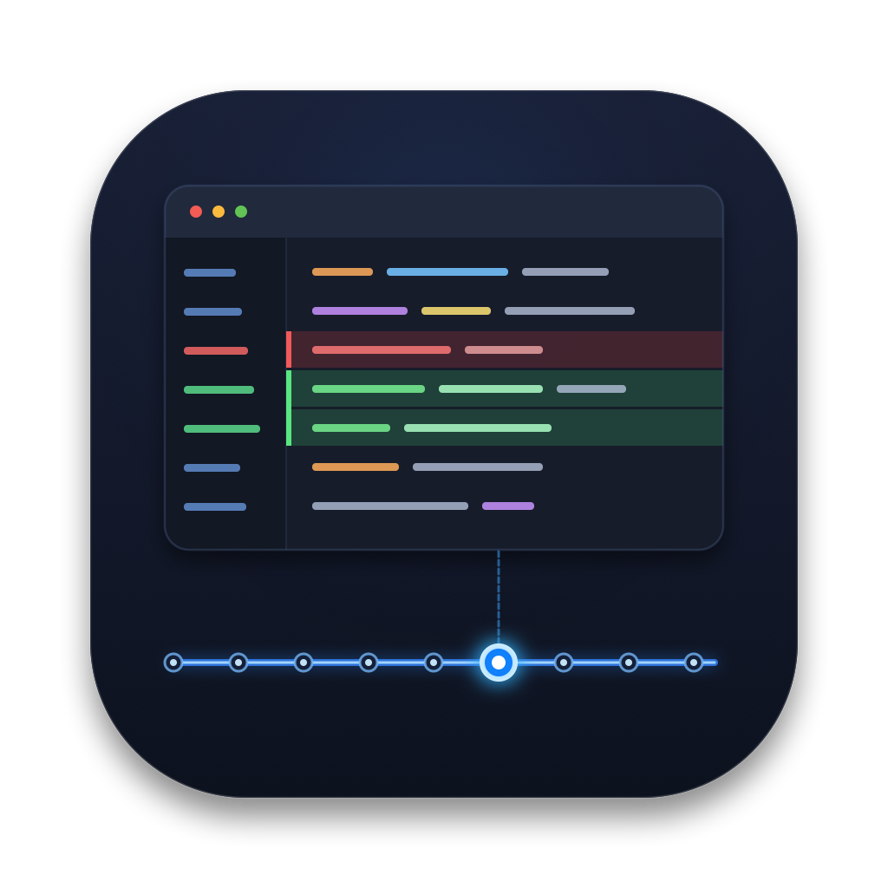
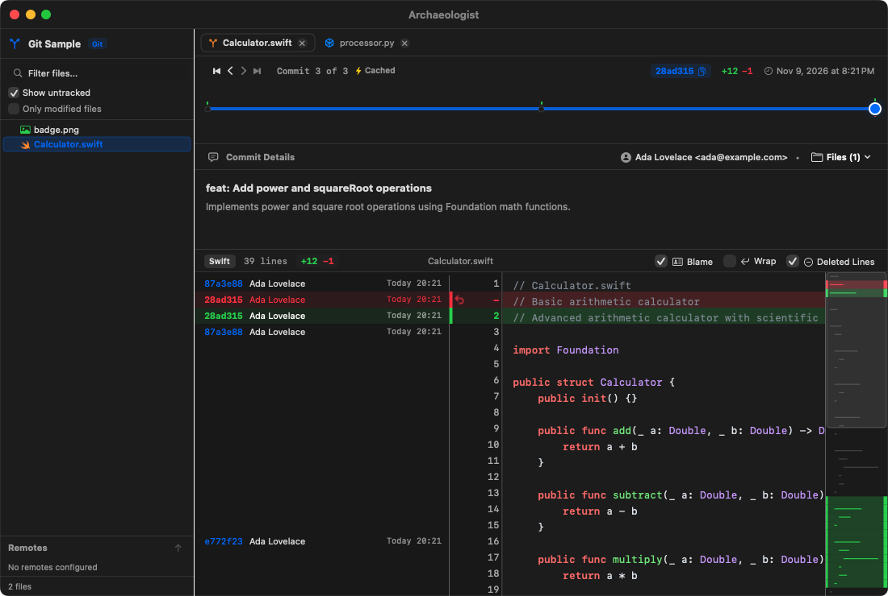

# Archaeologist

<p align="center">
  
</p>

<p align="center">
  <strong>A native macOS timeline browser for inspecting file evolution across Git and Mercurial commits.</strong>
</p>

<p align="center">
  
  
  
</p>

---

## Overview

**Archaeologist** gives developers a visual timeline of a single file's commit history. Instead of switching between `git log`, `git show`, and `git blame` in a terminal, or waiting on heavy full-repository GUIs, Archaeologist focuses purely on the file you care about:

1. **Scrub the timeline** to immediately view the file snapshot at any revision.
2. **See changes at a glance** with green highlight for added lines and soft red highlight for interleaved deleted lines.
3. **Inspect blame metadata** aligned in a fixed, non-wrapping gutter.
4. **Instant scrubbing** powered by an intelligent background caching engine that preloads revisions outward from your current position.

---

## Layout

<p align="center">
  
</p>

The application window is organized into four clean, stacked sections:

1. **Multi-Tab Bar**:
   - Tab-based file browsing: each tab represents a file snapshot under a specific VCS.
   - A single file existing in both Git and Mercurial can be opened in separate, side-by-side tabs.
   - Dedicated Back button (`Cmd+[`), tab close controls (`Cmd+W`), and New Tab button (`Cmd+T`).

2. **Timeline Bar**:
   - Clean, scrubbable track displaying every commit touching the file as an interactive node dot.
   - Navigation steppers: **First (`|<`)**, **Previous (`<`)**, **Next (`>`)**, and **Latest (`>|`)**.
   - Dual-VCS swap badge (`[Git ⇄]` / `[Hg ⇄]`): when a file exists in both repositories, click to instantly switch between VCS histories.
   - Revision badge with one-click revision hash copying, clock icon, and commit timestamp.
   - Background preloading status indicator (`Caching x/y...` / `Cached`).

3. **Commit Details View**:
   - Resizable bottom pane displaying commit subject, body description, and full author with email address (`Author <email>`).
   - **Files in Commit Dropdown**: Shows all files changed in the currently selected commit; selecting any file opens it at that exact revision.

4. **Content & Blame View**:
   - **Syntax Highlighting**: Built-in support for Swift, C/C++, Python, JavaScript/TypeScript, Rust, Go, Java, Ruby, Shell, HTML, CSS, JSON, YAML, SQL, and Markdown.
   - **Blame Gutter**: Shows short revision, author name (with expanded width to avoid truncation), and relative/formatted date.
   - **Interactive Blame**: Click any line in the blame gutter to jump immediately to the commit where that line was introduced.
   - **Change Visualization**: Added lines highlighted in soft green; deleted lines interleaved at their original location with a soft red background and `-` marker.
   - **Line Wrapping Toggle**: Toggle soft line wrapping on or off via the toolbar.
   - **Image Support**: Previews images (`.png`, `.jpg`, `.gif`, `.webp`, `.bmp`, `.svg`, etc.) across revisions with transparency checkerboard and zoom controls.

---

## Features

- **Multi-Tab Browsing**:
  - Independent tabs per file and version control system.
- **Back-Stack Navigation**:
  - Tracks every file and revision transition with a Back button (`Cmd+[`).
  - Intelligent deduplication: revisiting the same revision does not clutter the back stack.
  - Scrubbing slider history: dragging the timeline slider only records the start state upon mouse release, preventing scrub spam.
- **Dual VCS Support**:
  - Native integration with both **Git** and **Mercurial (`hg`)** repositories.
  - Automatically detects repository roots, including nested Git sub-repositories inside Mercurial trees.
  - Clickable swap badge when a file exists in both Git and Mercurial.
- **Native Look & Feel**:
  - Built with SwiftUI and AppKit following Apple's Human Interface Guidelines.
  - Full support for macOS Dark and Light Appearance.

---

## Keyboard Shortcuts

| Shortcut | Action |
| :--- | :--- |
| `Cmd + Left Arrow` (`⌘←`) | Previous Commit |
| `Cmd + Right Arrow` (`⌘→`) | Next Commit |
| `Cmd + Option + Left Arrow` (`⌥⌘←`) | First (Oldest) Commit |
| `Cmd + Option + Right Arrow` (`⌥⌘→`) | Latest (Newest) Commit |
| `Cmd + [` | Go Back in History |
| `Cmd + T` | New Tab |
| `Cmd + W` | Close Tab |
| `Cmd + O` | Open File Dialog |
| `Cmd + C` (Context menu) | Copy Selected Line / Commit Hash |

---

## Building & Running

### Requirements
- macOS 14.0 or newer
- Xcode 16.0+ (Swift 5.0 / 6.0)
- `git` and/or `hg` (Mercurial) installed on your system (e.g., `/usr/bin/git`, `/opt/homebrew/bin/hg`)

### Build from Command Line

```bash
# Clone or navigate to the repository
cd Archaeologist

# Build Debug Application
xcodebuild build -scheme Archaeologist -derivedDataPath ./DerivedData -destination 'platform=macOS'

# Run Application
open ./DerivedData/Build/Products/Debug/Archaeologist.app
```

### Run Tests

A comprehensive test suite of unit tests validates ProcessRunner binary resolution, Git/Hg diff deletion extraction, streaming delta reconstruction, user revision prioritization, multi-tab management, timeline scrubbing, and directory watching.

Run all tests in Xcode via **Product > Test** (⌘U) or from the command line:

```bash
xcodebuild test -scheme Archaeologist -destination 'platform=macOS'
```

---

## License

MIT License. See [LICENSE](LICENSE) for details.
